# DER — Diagrama Entidade-Relacionamento

Modelo físico do banco PostgreSQL 16 do Urbaniza, com as 14 tabelas e as colunas exatas da seção C4 do contrato técnico (o texto do contrato menciona "13 tabelas", mas a própria seção C4 e o script `01_schema.sql` definem 14). As colunas marcadas como extensão (E1 e E2) estão justificadas em [decisões de modelagem](decisoes-de-modelagem.md).

Convenções:

- Tabelas e colunas em `snake_case` minúsculo.
- Toda chave primária `id` é `BIGINT GENERATED ALWAYS AS IDENTITY`, exceto nas subtabelas de herança (`escola`, `unidade_saude`, `criterio_alagamento`, `criterio_declividade`, `criterio_geologico`, `criterio_preservacao`), cuja chave primária `id` é também chave estrangeira para a tabela-mãe.
- No diagrama, o tipo `DOUBLE_PRECISION` representa `DOUBLE PRECISION` (o Mermaid não aceita espaço no nome do tipo).
- Herança mapeada por tabela por subclasse (JOINED) com a coluna discriminadora `tipo` na tabela-mãe.

## Diagrama

```mermaid
erDiagram
    regiao {
        BIGINT id PK "IDENTITY"
        VARCHAR(150) nome "NOT NULL UNIQUE"
        DOUBLE_PRECISION area_total_m2 "NOT NULL CHECK > 0"
        DOUBLE_PRECISION area_verde_m2 "NOT NULL DEFAULT 0 CHECK >= 0"
        DOUBLE_PRECISION area_impermeavel_m2 "NOT NULL DEFAULT 0 CHECK >= 0"
        INT populacao_atual "NOT NULL DEFAULT 0 CHECK >= 0"
        DOUBLE_PRECISION declividade_media_pct "NOT NULL DEFAULT 0 CHECK >= 0 (E1)"
    }

    loteamento {
        BIGINT id PK "IDENTITY"
        BIGINT regiao_id FK "NOT NULL"
        VARCHAR(150) denominacao "NOT NULL"
        DATE data_aprovacao "NULL = ainda não aprovado"
        DOUBLE_PRECISION area_gleba_m2 "NOT NULL CHECK > 0"
        INT populacao_estimada "NOT NULL CHECK >= 0"
        BOOLEAN ocupado "NOT NULL DEFAULT FALSE"
    }

    lote {
        BIGINT id PK "IDENTITY"
        BIGINT loteamento_id FK "NOT NULL"
        VARCHAR(20) quadra "NOT NULL"
        VARCHAR(20) numero "NOT NULL"
        DOUBLE_PRECISION area_m2 "NOT NULL CHECK >= 125 (RN05)"
        DOUBLE_PRECISION frente_m "NOT NULL CHECK >= 5 (RN05)"
    }

    equipamento_comunitario {
        BIGINT id PK "IDENTITY"
        BIGINT regiao_id FK "NULL"
        VARCHAR(150) nome "NOT NULL"
        INT capacidade_instalada "NOT NULL CHECK >= 0"
        VARCHAR(20) tipo "NOT NULL ESCOLA ou UNIDADE_SAUDE"
    }

    escola {
        BIGINT id PK, FK
        DOUBLE_PRECISION percentual_idade_escolar "NOT NULL CHECK > 0 AND <= 100"
        VARCHAR(50) nivel_ensino "NOT NULL"
    }

    unidade_saude {
        BIGINT id PK, FK
        INT habitantes_por_equipe "NOT NULL CHECK > 0"
        VARCHAR(50) tipo_unidade "NOT NULL"
    }

    analista {
        BIGINT id PK "IDENTITY"
        VARCHAR(150) nome "NOT NULL"
        VARCHAR(30) matricula "NOT NULL UNIQUE"
        VARCHAR(80) setor "NOT NULL"
    }

    criterio_vedacao {
        BIGINT id PK "IDENTITY"
        BIGINT regiao_id FK "NOT NULL (E2)"
        VARCHAR(30) codigo_interno "NOT NULL UNIQUE"
        VARCHAR(150) fundamento_legal "NOT NULL"
        VARCHAR(30) tipo "NOT NULL ALAGAMENTO DECLIVIDADE GEOLOGICO PRESERVACAO"
    }

    criterio_alagamento {
        BIGINT id PK, FK
        BOOLEAN saneamento_executado "NOT NULL"
    }

    criterio_declividade {
        BIGINT id PK, FK
        DOUBLE_PRECISION declividade_limite "NOT NULL DEFAULT 30 CHECK > 0"
    }

    criterio_geologico {
        BIGINT id PK, FK
        VARCHAR(150) laudo_geotecnico "NOT NULL começa com ADEQUADO ou INADEQUADO"
    }

    criterio_preservacao {
        BIGINT id PK, FK
        BOOLEAN area_protegida "NOT NULL"
    }

    analise_parcelamento {
        BIGINT id PK "IDENTITY"
        BIGINT regiao_id FK "NOT NULL"
        BIGINT analista_id FK "NOT NULL"
        TIMESTAMP data_emissao "NOT NULL DEFAULT now()"
        VARCHAR(50) versao_dados "NOT NULL"
        VARCHAR(25) resultado "NOT NULL APTA APTA_COM_RESTRICAO INAPTA"
        DOUBLE_PRECISION indice_area_verde_apurado "NULL se população projetada = 0"
        TEXT parecer_textual "NOT NULL"
    }

    analise_criterio {
        BIGINT analise_id PK, FK
        BIGINT criterio_id PK, FK
        BOOLEAN resultado "NOT NULL TRUE = critério atendido"
        TEXT descricao_impedimento "NULL"
    }

    regiao ||--o{ loteamento : "contém (CASCADE)"
    loteamento ||--o{ lote : "contém (CASCADE)"
    regiao |o--o{ equipamento_comunitario : "possui (SET NULL)"
    equipamento_comunitario ||--o| escola : "especializa"
    equipamento_comunitario ||--o| unidade_saude : "especializa"
    regiao ||--o{ criterio_vedacao : "vedações (CASCADE)"
    criterio_vedacao ||--o| criterio_alagamento : "especializa"
    criterio_vedacao ||--o| criterio_declividade : "especializa"
    criterio_vedacao ||--o| criterio_geologico : "especializa"
    criterio_vedacao ||--o| criterio_preservacao : "especializa"
    regiao ||--o{ analise_parcelamento : "analisada em (RESTRICT)"
    analista ||--o{ analise_parcelamento : "emite (RESTRICT)"
    analise_parcelamento ||--o{ analise_criterio : "aplica (CASCADE)"
    criterio_vedacao ||--o{ analise_criterio : "usado em (RESTRICT)"
```

## Restrições complementares

| Tabela | Restrição |
|--------|-----------|
| `regiao` | `CHECK (area_verde_m2 + area_impermeavel_m2 <= area_total_m2)` |
| `lote` | `UNIQUE (loteamento_id, quadra, numero)` |
| `criterio_geologico` | `CHECK (laudo_geotecnico ~ '^(ADEQUADO|INADEQUADO)')` — formato "ADEQUADO" ou "INADEQUADO", opcionalmente seguido de ": resumo do laudo" |
| `analise_criterio` | `PRIMARY KEY (analise_id, criterio_id)`; `descricao_impedimento` preenchida somente quando `resultado = FALSE` |

Índices em toda coluna de chave estrangeira que não é chave primária: `loteamento.regiao_id`, `lote.loteamento_id`, `equipamento_comunitario.regiao_id`, `criterio_vedacao.regiao_id`, `analise_parcelamento.regiao_id`, `analise_parcelamento.analista_id` e `analise_criterio.criterio_id`.

## Ações ON DELETE

| Tabela (coluna FK) | Referencia | ON DELETE | Significado |
|--------------------|------------|-----------|-------------|
| `loteamento` (`regiao_id`) | `regiao(id)` | `CASCADE` | Composição: excluir a região exclui seus loteamentos. |
| `lote` (`loteamento_id`) | `loteamento(id)` | `CASCADE` | Composição: excluir o loteamento exclui seus lotes. |
| `equipamento_comunitario` (`regiao_id`) | `regiao(id)` | `SET NULL` | Agregação: o equipamento permanece cadastrado, sem região. |
| `escola` (`id`) | `equipamento_comunitario(id)` | `CASCADE` | Herança: excluir o equipamento exclui a linha da subtabela. |
| `unidade_saude` (`id`) | `equipamento_comunitario(id)` | `CASCADE` | Herança: excluir o equipamento exclui a linha da subtabela. |
| `criterio_vedacao` (`regiao_id`) | `regiao(id)` | `CASCADE` | Os critérios descrevem fatos da região e são excluídos com ela (E2). |
| `criterio_alagamento` (`id`) | `criterio_vedacao(id)` | `CASCADE` | Herança. |
| `criterio_declividade` (`id`) | `criterio_vedacao(id)` | `CASCADE` | Herança. |
| `criterio_geologico` (`id`) | `criterio_vedacao(id)` | `CASCADE` | Herança. |
| `criterio_preservacao` (`id`) | `criterio_vedacao(id)` | `CASCADE` | Herança. |
| `analise_parcelamento` (`regiao_id`) | `regiao(id)` | `RESTRICT` | Rastreabilidade (RN16): região com análise emitida não pode ser excluída. |
| `analise_parcelamento` (`analista_id`) | `analista(id)` | `RESTRICT` | Rastreabilidade (RN16): analista com análise emitida não pode ser excluído. |
| `analise_criterio` (`analise_id`) | `analise_parcelamento(id)` | `CASCADE` | Excluir a análise exclui seus resultados por critério. |
| `analise_criterio` (`criterio_id`) | `criterio_vedacao(id)` | `RESTRICT` | Rastreabilidade (RN16): critério usado em análise não pode ser excluído. |

Consequências operacionais tratadas pela aplicação com mensagem amigável:

- Excluir uma região **com** análises emitidas é bloqueado (`RESTRICT`).
- Excluir uma região **sem** análises apaga em cascata seus loteamentos, lotes e critérios; os equipamentos ficam sem região (`regiao_id = NULL`).
- Excluir um critério usado em alguma análise é bloqueado (`RESTRICT`).
- Excluir um analista com análises é bloqueado (`RESTRICT`).
